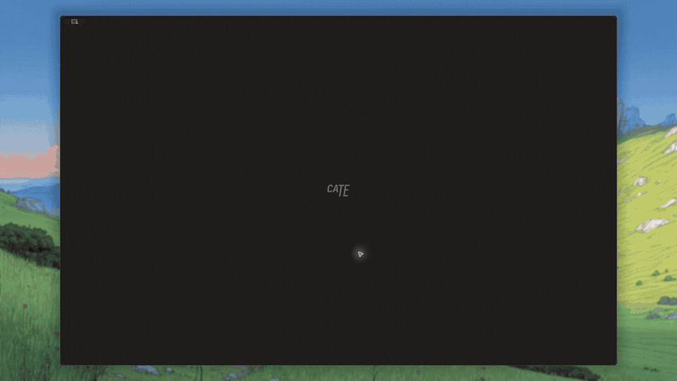

<p align="center">
  <picture>
    <source media="(prefers-color-scheme: dark)" srcset="assets/cate-logo.svg" />
    
  </picture>
</p>

<p align="center">
  <a href="README.md">English</a> | <a href="README.fr.md">Français</a> | <a href="README.zh-CN.md">简体中文</a> | <a href="README.de.md">Deutsch</a>
</p>

<p align="center">
  An infinite canvas IDE for parallel coding agents.
</p>

<p align="center">
  <a href="LICENSE"></a>
  <a href="https://github.com/0-AI-UG/cate/actions"></a>
  <a href="https://github.com/0-AI-UG/cate/releases"></a>
</p>

---

<p align="center">
  
</p>

Run Claude Code, Codex, or any agent CLI in a Cate terminal and the canvas becomes mission control: every terminal shows whether its agent is working, finished, or waiting on you, and Cate notifies you the moment one needs input. One click spins up a git worktree with its own colored territory on the canvas, so five agents on five branches stay five visibly separate workstreams instead of a pile of tabs.

Share that workspace across computers and your iPhone, or invite someone to work alongside you. Everyone connects to the same running workspace, with live terminals, editor buffers, agent conversations, and canvas layouts. Run it on your laptop or a remote machine and follow the work from another device.

Open a folder and it becomes a workspace. No config files.

<p align="center">
  <em>Pst. Hey, you, join our stargazers :)</em>
</p>

<p align="center">
  <a href="https://github.com/0-AI-UG/cate"></a>
</p>

## Install

Download a prebuilt release. Don't build from source for daily use.

| Platform | Formats | Link |
|----------|---------|------|
| macOS | DMG, ZIP (`arm64`, `x64`) | [Latest release](https://github.com/0-AI-UG/cate/releases/latest) |
| Windows | NSIS installer, ZIP (`x64`) | [Latest release](https://github.com/0-AI-UG/cate/releases/latest) |
| Linux | AppImage, DEB, `tar.gz` (`x64`) | [Latest release](https://github.com/0-AI-UG/cate/releases/latest) |

On macOS you can also install with Homebrew:

```sh
brew install --cask cate
```

## What's inside

- **Shared live workspaces.** Pair devices to work together in the same workspace. Panels, editor buffers, agent conversations, and layouts stay in sync, with presence showing who else is connected.
- **Agent-aware terminals.** Supported agent CLIs report turn start, turn end, and permission prompts, so each panel shows running / waiting / finished and pings you when it needs an answer.
- **Agent sessions survive restarts.** Reopen the project and terminals come back with their scrollback, each agent reattached with its own resume command.
- **Shared agent prompt queues.** Send prompts with file or photo attachments from the app or CLI. The runtime holds each panel's queue, so connected clients see the same pending and failed prompts.
- **Agent usage overview.** Track workspace token usage and API-equivalent cost by time, agent, and model, plus Claude Code and Codex subscription limits, from the Usage button in the sidebar.
- **Worktrees for parallel branches.** Type what you're working on and Cate creates the worktree and branch, off a local branch, a remote branch, or an open PR.
- **Panels on a canvas or in a dock.** Terminals, Monaco editors, browsers, PDF/image/DOCX viewers, nested canvases. Float, dock into tabs and splits, or detach into their own window. Layout persists per project.
- **Git and search.** Multi-repo source control, git badges in the file tree, side-by-side diffs, ripgrep search, and `Cmd+K` for commands, panels, and files.
- **A CLI agents can call.** In a Cate terminal, `cate` drives a browser panel, reads another terminal, opens files, manages panels, and starts or prompts agents.
- **Local and remote are the same path.** Open a folder on your computer, an SSH host, or a WSL distro. Terminals, git, search, and agents run on the machine holding the workspace.

Press `Cmd+K` for everything else. Shortcuts are rebindable in Settings.

## Shared workspaces and remote access

Open **Share** in a workspace to pair another device using a QR code or pairing code. Devices connect over the same network or through Cate Connect from anywhere, with end-to-end encryption. Paired devices remember the workspace for future connections; removing a device revokes its access and disconnects it immediately.

You can use the workspace from several devices yourself or share it with trusted collaborators. Everyone sees and controls the same live workspace, including its files, terminals, agents, panels, and layout. Every paired device has full workspace access. The iOS app lets you follow agent conversations, send prompts and attachments, and use workspace panels from your iPhone.

Each workspace has a background runtime on the machine holding its files. Cate installs it when you open a workspace on an SSH host or WSL distro, so the work runs there while your devices connect to it.

In Workspace Settings → Availability, choose what happens when you close Cate: finish what's running and then stop, always stay available, or stop with Cate. A paired device can reconnect while the workspace is running, but cannot start a stopped workspace.

Clients and workspace runtimes must use the same Cate version. Cate updates older runtimes automatically when idle, or asks first when work is running; if a runtime is newer, update your app.

## Contributing

Build-from-source instructions and the contribution workflow are in [CONTRIBUTING.md](CONTRIBUTING.md). Release history is in the [CHANGELOG](CHANGELOG.md).

## License

[MIT](LICENSE)
